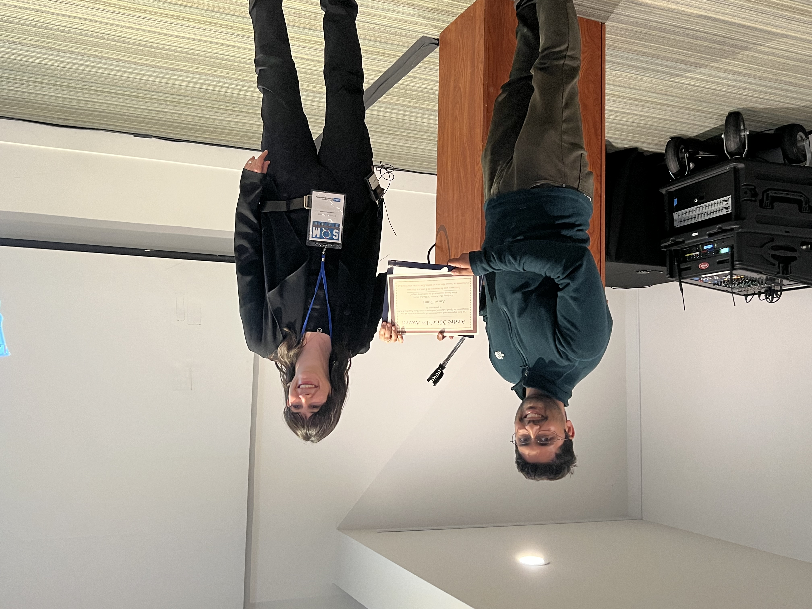

## Andre Mischke Award — Best Experimental Talk

:::: {.award-feature}

::: {.award-feature-top}

::: {.award-feature-text}
**22nd International Conference on Strangeness in Quark Matter (SQM 2026)**  
Los Angeles, California · 2026

The Andre Mischke Award was established in memory of Andre Mischke—a friend, educator,
and scholar whose career combined major contributions to heavy-flavour physics with a deep
commitment to mentoring and supporting young scientists. The award recognizes the best
experimental presentation by a young scientist at the Strangeness in Quark Matter
conference.
:::

::: {.award-feature-image}
{width=100%}
:::

:::

I received the award at SQM 2026 for my presentation on the ATLAS measurement of
radial-flow fluctuations in Pb+Pb collisions.

::: {.project-links}
[View the Talk](projects/radial-flow-collectivity/talks/sqm-2026.qmd){.btn .btn-primary}
[Award Presentation][sqm-award]{.btn .btn-outline-primary}
:::

::::

[sqm-award]: https://indico.global/event/13943/contributions/143709/attachments/68482/132707/andre_mischke_award_presentation_2026_Los_Angeles.pdf