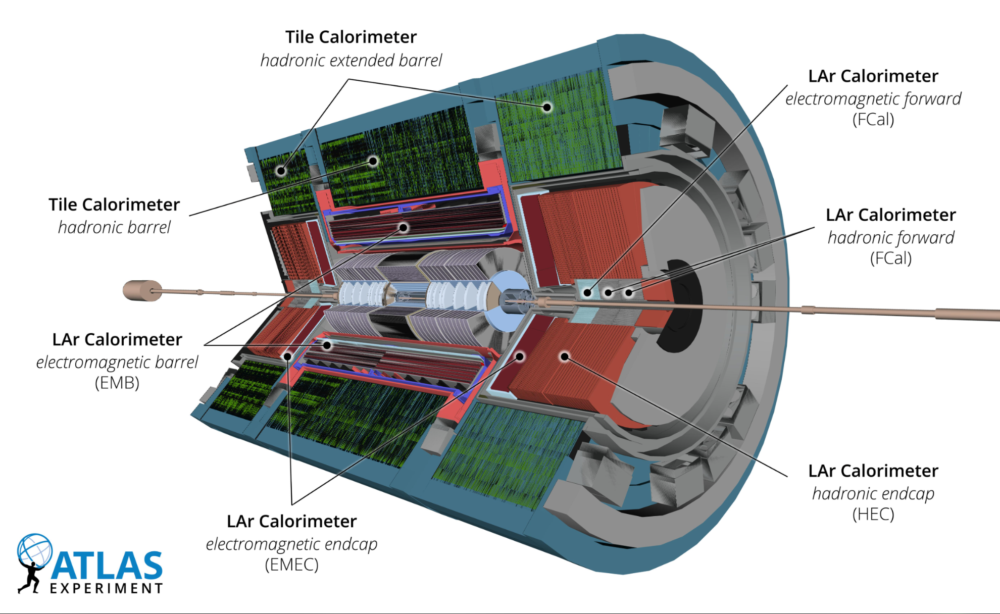
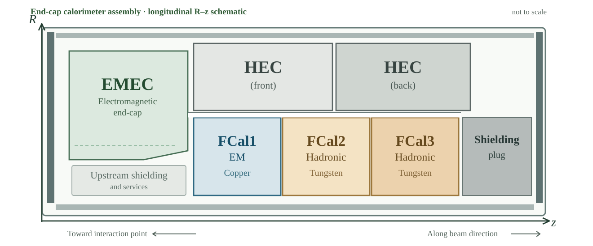

## Calorimetry {#calorimetry .atlas-view-switch}

ATLAS calorimeters measure particle energy by sampling the showers produced as
particles pass through alternating **absorber** and **active** layers. The system
combines a central steel-and-scintillator Tile calorimeter with liquid-argon (LAr)
calorimeters covering the electromagnetic, hadronic end-cap, and forward regions.

Select **Full Detector** to view the official labelled calorimeter cutaway, or choose
**R–z Layout** to examine the longitudinal arrangement near the beam axis.

::: {.atlas-view-panel data-view-panel="full" data-view-label="Full Detector"}
### Full detector calorimeter view {.atlas-view-panel__title}

{loading="lazy" decoding="async"}

*Official ATLAS calorimeter cutaway, Figure 5 of the Run 3 detector paper.*
:::

::: {.atlas-view-panel data-view-panel="rz" data-view-label="R–z Layout"}
### Longitudinal R–z calorimeter layout {.atlas-view-panel__title}

{loading="lazy" decoding="async"}

*Longitudinal R–z schematic of one end-cap, adapted from the 2008 ATLAS detector paper; not to scale.*
:::

ATLAS Collaboration, [Run 3 detector paper, Figure 5](https://doi.org/10.1088/1748-0221/19/05/P05063) [@atlas-run3-detector] · ATLAS Experiment © CERN. [Official image](https://cds.cern.ch/record/2900788). R–z schematic adapted from the [ATLAS detector paper, Figure 5.19](https://doi.org/10.1088/1748-0221/3/08/S08003) [@atlas-detector-2008].

**Electromagnetic calorimeters (EMB and EMEC).** The LAr electromagnetic barrel
(EMB) and electromagnetic end-cap (EMEC) measure showers initiated primarily by
electrons and photons. Layers of lead absorbers and liquid argon provide fine spatial
sampling of deposited energy.

**Tile hadronic calorimeters.** A central barrel and two extended barrels use steel
absorbers and scintillating tiles to sample hadronic showers. These measure much
of the energy carried by strongly interacting particles in the central region.

**Hadronic end-cap calorimeters (HEC).** Located at larger angles to the beam than
the FCal, the HEC uses copper absorbers and liquid argon to measure hadronic energy
in the end-cap region.

**Forward calorimeters (FCal).** Close to the beam axis, the FCal extends coverage
to approximately $3.1 < |\eta| < 4.9$. Each end-cap contains three LAr modules:
**FCal1** uses copper absorbers for electromagnetic showers, while **FCal2** and
**FCal3** use tungsten absorbers for hadronic showers. In the R–z view, their order
along the beam direction is visible alongside the EMEC and HEC modules.
