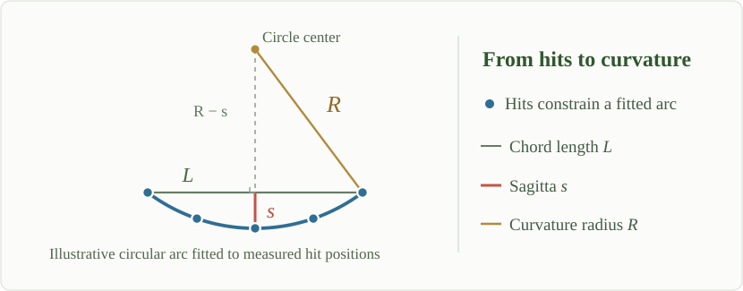

#### Momentum Measurement {.atlas-view-panel .atlas-momentum}

  
The interactive curvature diagram is an optional enhancement. The complete derivation remains below.

::: {.atlas-momentum__explanation}

##### From detector hits to transverse momentum

**1. Fit a curved track.** Position measurements across the Pixel, SCT, and TRT
layers are combined into a trajectory. The track fit determines its curvature using
the known magnetic field. The geometry below explains the basic idea with a circular arc.

{.atlas-momentum__sagitta loading="lazy" decoding="async"}

*Original explanatory SVG. The three-point sagitta construction illustrates the geometry of curvature; ATLAS fits many detector measurements.*

**2. Determine the curvature radius.** For a circle, the chord length $L$ and
sagitta $s$ form a right triangle. The Pythagorean theorem gives

$$
R^2 = (R-s)^2 + \left(\frac{L}{2}\right)^2,
\qquad
R = \frac{L^2}{8s} + \frac{s}{2}.
$$

For a small sagitta, $s \ll L$, the second term is small, so
$R \approx L^2/(8s)$. Less bending means a smaller sagitta and a larger curvature radius.

**3. Convert curvature to momentum.** In a uniform magnetic field, the transverse
Lorentz force is the force required to bend the transverse momentum:

$$
|q|v_{\mathrm{T}}B = \frac{p_{\mathrm{T}}v_{\mathrm{T}}}{R}
\quad\Longrightarrow\quad
p_{\mathrm{T}} = |q|BR,
$$

and in practical high-energy-physics units,

$$
p_{\mathrm{T}}\,[\mathrm{GeV}/c]
\approx 0.2998\,|z|\,B\,[\mathrm{T}]\,R\,[\mathrm{m}].
$$

Here $z=q/e$ is the signed charge number. With $B \approx 2\,\mathrm{T}$ and the
usual singly charged track assumption ($|z|=1$),
$p_{\mathrm{T}}\,[\mathrm{GeV}/c] \approx 0.6R\,[\mathrm{m}]$. The bending direction
gives the charge sign; identifying the particle species is not required under this
charge assumption.

*Educational approximation:* the interactive arcs use a uniform 2 T solenoidal
field and idealized measurements. Real ATLAS track fits account for magnetic-field
variations, measurement uncertainties, material interactions, and multiple scattering.
Layer radii follow the [ATLAS Inner Detector documentation](https://atlas.cern/Discover/Detector/Inner-Detector)
and published [barrel geometry specifications](https://inspirehep.net/files/4f89a06d335df8bf2f25b8974799be9f).
Field strength: [ATLAS Magnet System](https://www.atlas.cern/Discover/Detector/Magnet-System).

:::
