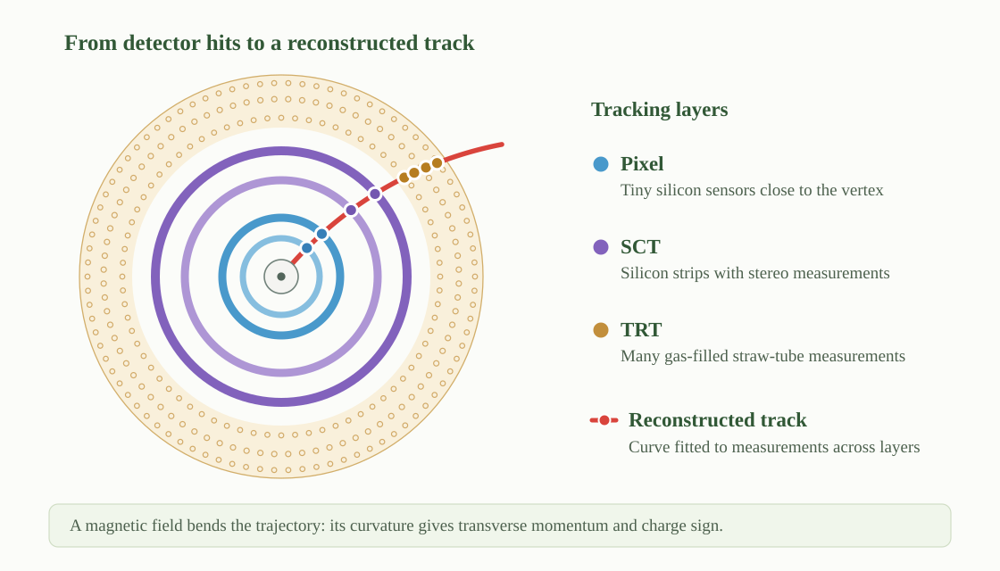

## What Parts of the Detector I Use in My Analysis

My heavy-ion analyses combine **charged-particle tracks in the Inner Detector**,
**forward transverse energy in the FCal**, and **very-forward neutron energy in
the Zero Degree Calorimeters (ZDCs)**. Together, these measurements provide the
physics observables, event classification, and pileup rejection used in the analysis.

| Detector region | Measurement used | Role in the analysis |
|---|---|---|
| Inner Detector, $|\eta| < 2.5$ | Track $p_{\mathrm{T}}$, $\eta$, and $\phi$ | Multiplicity, mean transverse momentum, and flow vectors |
| Forward Calorimeter, $3.1 < |\eta| < 4.9$ | Summed transverse energy, $\Sigma E_{\mathrm{T}}$ | Event selection and centrality classification |
| Zero Degree Calorimeters, $|\eta| > 8.3$ | Very-forward neutron energy, $E_{\mathrm{ZDC}}$ | Pileup rejection using the ZDC--FCal energy correlation |

### Inner Detector: Charged-Particle Tracking {.atlas-view-switch}

The Inner Detector is the main ATLAS system for reconstructing charged particles
near **midrapidity**—the central detector region, away from the beam directions.
It provides precision tracking over approximately $|\eta| < 2.5$ and surrounds
the beam pipe with several nested tracking layers,
so particles emerging from the collision leave a sequence of spatial measurements
as they move outward through the detector.

::: {.atlas-view-panel data-view-panel="concept" data-view-label="Concept"}
#### Tracking concept {.atlas-view-panel__title}

{fig-alt="Concentric Pixel, SCT, and TRT tracking layers crossed by a curved red trajectory with measurement points; a legend identifies the detector technologies." loading="lazy" decoding="async"}

*Conceptual tracking illustration (not to scale). The curved track is fitted using measurements from successive detector layers.*
:::

::: {.atlas-view-panel data-view-panel="details" data-view-label="Details"}
#### Detector-layer details {.atlas-view-panel__title}

{fig-alt="ATLAS tracking detector cutaway showing the radii of Pixel, SCT, and TRT components beside diagrams of pixel hits, paired silicon-strip measurements, and straw-tube drift-time measurements." loading="lazy" decoding="async"}

*Pixel sensors provide two-dimensional measurements; stereo SCT modules combine strip measurements; TRT straws provide drift-time measurements and transition-radiation information. Detector geometry: [ATLAS Collaboration, detector paper, Figure 4.2](https://cds.cern.ch/record/1129811/files/jinst8_08_s08003.pdf). This measurement-principle composite is reproduced in [X. Ai et al., ACTS for gaseous tracking detectors (FTCF 2024), slide 6](https://indico.pnp.ustc.edu.cn/event/91/contributions/6669/attachments/1933/3183/ACTS_Xiaocong_FTCF.pdf). ATLAS Experiment © CERN.*
:::



#### Tracking reconstruction {.tracking-continuation}

In broad terms, tracking works in three steps. First, the **Pixel detector**, the
**silicon microstrip tracker (SCT)**, and the **transition radiation tracker (TRT)**
record discrete position measurements, usually called **hits**. Second, pattern-
recognition algorithms identify groups of hits that belong to the same particle and
fit them to a common trajectory. Third, because the particle moves in the ATLAS
solenoidal magnetic field, the trajectory bends: the amount of curvature determines
the transverse momentum $p_{\mathrm{T}}$, while the direction of curvature identifies
the sign of the electric charge. The fitted trajectory also gives the particle's
direction and point of closest approach to the collision vertex.

For my analyses, each reconstructed track supplies its transverse momentum
$p_{\mathrm{T}}$, pseudorapidity $\eta$, and azimuthal angle $\phi$. These
quantities are used to measure charged-particle multiplicity, event-by-event mean
transverse momentum, and flow vectors. The tracking system is therefore the detector
element that directly measures the particles entering the core physics observables.

### Forward Calorimeters: Event Selection and Centrality

The forward calorimeters measure transverse energy at large pseudorapidity,
separated from the midrapidity tracks used in my analysis. Their summed energy
$\Sigma E_{\mathrm{T}}$ defines event-activity or **centrality percentiles**.
The relationship between those percentiles and the overlap geometry of the
colliding nuclei is inferred with a Glauber-based collision model rather than
measured directly by the FCal.

Using forward energy for event classification and inner-detector tracks for the
physics observables helps reduce **self-correlations**—artificial relationships
that can appear when the same particles influence both the event class and the
observable. The separation between tracking and forward calorimetry is therefore
an important part of the analysis strategy.

### Zero Degree Calorimeters: Pileup Rejection

The Zero Degree Calorimeters are located about 140 m from the interaction point,
close to the outgoing beam directions. They measure very-forward neutral particles,
primarily spectator neutrons that continue along the beam line after the collision.
In the Pb+Pb analysis, the correlation between the energy recorded in the ZDCs and
the FCal $\Sigma E_{\mathrm{T}}$ is used to identify events inconsistent with a
single collision and reject them as pileup. The ZDC measurement therefore supports
event cleaning rather than entering the final physics observables directly
[@atlas-momentum-fluctuations-2024].
