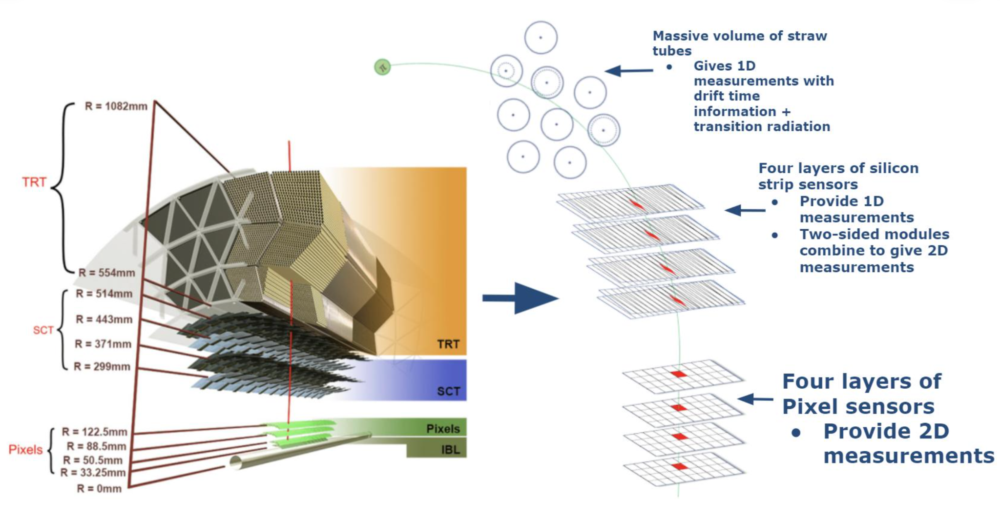

## What Parts of the Detector I Use in My Analysis

My heavy-ion analyses mainly combine two detector measurements: **charged-particle
tracks in the Inner Detector** and **forward transverse energy in the FCal**.
They probe different regions of a collision and serve distinct purposes.

### Inner Detector: Charged-Particle Tracking {.atlas-view-switch}

The Inner Detector is the main ATLAS system for reconstructing charged particles
near midrapidity. It surrounds the beam pipe with several nested tracking layers,
so particles emerging from the collision leave a sequence of spatial measurements
as they move outward through the detector.

::: {.atlas-view-panel data-view-panel="concept" data-view-label="Concept"}
#### Tracking concept {.atlas-view-panel__title}

{loading="lazy" decoding="async"}

*Conceptual tracking illustration (not to scale). The curved track is fitted using measurements from successive detector layers.*
:::

::: {.atlas-view-panel data-view-panel="details" data-view-label="Details"}
#### Detector-layer details {.atlas-view-panel__title}

{loading="lazy" decoding="async"}

*Pixel sensors provide two-dimensional measurements; stereo SCT modules combine strip measurements; TRT straws provide drift-time measurements and transition-radiation information. Source: [X. Ai et al., ACTS for gaseous tracking detectors (FTCF 2024), slide 6](https://indico.pnp.ustc.edu.cn/event/91/contributions/6669/attachments/1933/3183/ACTS_Xiaocong_FTCF.pdf). Reuse permission for this image remains unresolved.*
:::



#### Tracking reconstruction {.tracking-continuation}

In broad terms, tracking works in three steps. First, the **Pixel detector**, the
**silicon microstrip tracker (SCT)**, and the **transition radiation tracker (TRT)**
record discrete position measurements, usually called **hits**. Second, pattern-
recognition algorithms identify groups of hits that belong to the same particle and
fit them to a common trajectory. Third, because the particle moves in the ATLAS
solenoidal magnetic field, the trajectory bends: the amount of curvature determines
the transverse momentum $p_{\mathrm{T}}$, while the direction of curvature identifies
the sign of the electric charge. The fitted trajectory also gives the particle's
direction and point of closest approach to the collision vertex.

For my analyses, these reconstructed tracks provide the charged particles whose
event-by-event kinematics are used to study multiplicity, mean transverse momentum,
and collective behavior in heavy-ion collisions. The tracking system is therefore
the detector element that directly measures the particles entering the core physics
observables.

### Forward Calorimeters: Event Selection and Centrality

The forward calorimeters measure transverse energy at large pseudorapidity,
separated from the midrapidity tracks used in my analysis. Their summed energy
provides an estimator of **collision centrality**, which is closely related to the
overlap geometry of the colliding nuclei.

Using forward energy for event classification and inner-detector tracks for the
physics observables helps reduce **self-correlations**: if the same particles were
used both to select an event class and to calculate the observable, the selection
could introduce artificial correlations. The separation between tracking and
forward calorimetry is therefore an important part of the analysis strategy.
