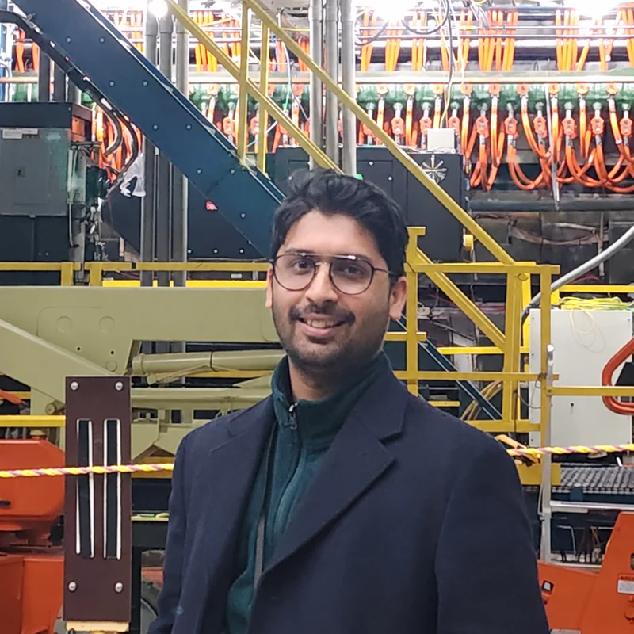
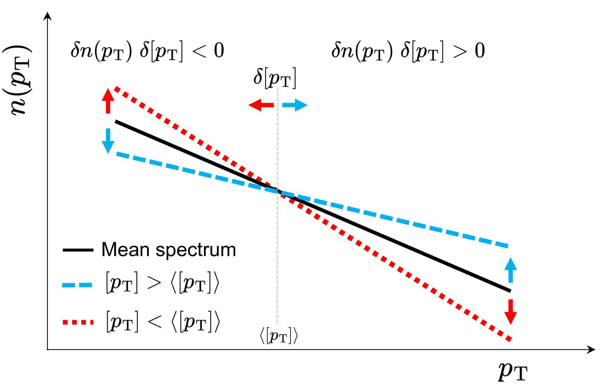

::: {.homepage-intro}
I study collective phenomena in high-energy nuclear collisions and use them to probe the
properties of the quark-gluon plasma. My work combines experimental measurements within the ATLAS Collaboration at the Large Hadron Collider with phenomenological studies using hydrodynamic and initial-state models.
:::

::: {.homepage-links}
[CV](cv.qmd){.btn .btn-outline-primary}
[Projects & Publications](publications.qmd){.btn .btn-primary}
[Talks & Posters](presentation.qmd){.btn .btn-outline-primary}
:::

:::: {.homepage-research}

::: {.homepage-profile role="complementary" aria-label="Profile and contact links"}

{.profile-photo alt="Aman Dimri standing in front of a particle detector."}

::: {.profile-affiliation}
**Graduate Researcher**\
Stony Brook University
:::

- [Email](mailto:aman.dimri@stonybrook.edu)
- [INSPIRE-HEP](https://inspirehep.net/authors/2621463)
- [GitHub](https://github.com/Skipper-Adimri)

:::

## Research Approach & Future Directions

I aim to find the simple ideas behind complex problems—and turn that understanding into useful solutions. My background in physics and computer science has taught me to bring mathematical reasoning, computational methods, and algorithmic thinking together in that search. Applying these approaches to demanding research questions has sharpened my intuition for recognizing promising directions. That experience has given me the confidence to tackle difficult problems and find a way forward.

Sometimes progress begins with a sudden insight that brings the key idea into focus. Other times, it emerges through patient exploration: questioning assumptions, testing different approaches, and gradually refining an idea until it becomes clear and defensible. Both paths combine creativity with the discipline of testing ideas against evidence. When progress slows, I explore other possibilities and seek fresh perspectives through collaboration.

My research in nuclear physics has given me a strong foundation for pursuing new questions with curiosity and scientific rigor. I am eager to apply this approach to challenging problems across science and technology, from fundamental research to practical applications. I want to pursue these challenges by **building on what I know, learning what I need, and exploring possibilities I can't yet see.**

## Research Interests

My current research and emerging interests span four areas—from nuclear physics to artificial intelligence—connected by the challenge of understanding complex behavior and determining which conclusions the evidence truly supports.

- **Collective Flow & Its Fluctuations:** Investigating how transverse momentum correlations and their event-by-event fluctuations reveal the collective dynamics and transport properties of the quark–gluon plasma.

- **Constraining Nuclear Structure Through High Energy Collisions:** Investigating how nuclear structure, particularly nuclear deformation, influences measurable observables in high-energy collisions, and using this sensitivity to constrain the properties of nuclei that are difficult to characterize through conventional methods.

- **Phenomenology & Modeling:** Developing analytical and computational approaches to connect initial-state physics, subsequent hydrodynamic evolution, and the final experimental measurements in high-energy nuclear collisions.

- **Artificial Intelligence & Reliable Reasoning:** Exploring how AI systems reason with scientific evidence, handle uncertainty and conflicting information, and how their reliability and robustness can be evaluated and improved.

## Featured Research

:::: {.featured-research}

### Evidence for the Collective Nature of Radial Flow

::: {.featured-research-top}

{.featured-research-image fig-alt="Schematic comparison of flatter and steeper particle spectra associated with higher and lower mean transverse momentum."}

::: {.featured-research-intro}
Radial flow characterizes the outward expansion of the quark-gluon plasma produced in
heavy-ion collisions. My recent work with the ATLAS Collaboration provided evidence for
the collective nature of radial-flow fluctuations through the first measurement of the
differential observable $v_0(p_T)$ in high-energy Pb+Pb collisions at a nucleon-pair
center-of-mass energy of 5.02 TeV.
:::

:::

The observed long-range correlations, transverse-momentum factorization, and
centrality-independent response shape provide complementary signatures of a collective
origin for radial-flow fluctuations. Comparison with hydrodynamic calculations further
revealed a distinctive sensitivity of the measured $v_0(p_T)$ shape to the bulk viscosity
of the quark-gluon plasma.

[Explore the Project](projects/radial-flow-collectivity/index.qmd){.btn .btn-primary}

::::

## Recent Highlight

::: {.project-award}
**Andre Mischke Award — Best Experimental Talk**

My presentation of the ATLAS radial-flow measurement at SQM 2026 received the
Andre Mischke Award for Best Experimental Talk.

[View the Talk](projects/radial-flow-collectivity/talks/sqm-2026.qmd){.btn .btn-outline-primary}
:::

::::
