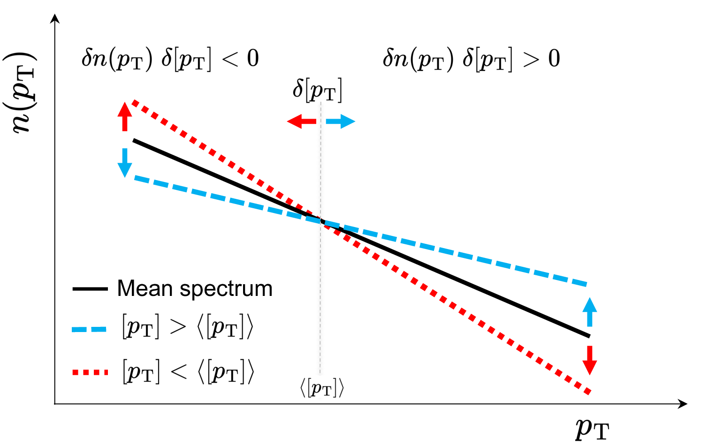

::: {.homepage-intro}
I study collective phenomena in high-energy nuclear collisions and use them to probe the
properties of the quark-gluon plasma. My work combines experimental measurements with the
**ATLAS Collaboration** at the Large Hadron Collider with phenomenological studies using
hydrodynamic and initial-state models.
:::

::: {.homepage-links}
[Publications](publications.qmd){.btn .btn-primary}
[Talks & Posters](presentation.qmd){.btn .btn-outline-primary}
<!--
[CV](files/CV_AmanDimri.pdf){.btn .btn-outline-primary}
-->
:::

## Research Interests

My research explores how the geometry and fluctuations of nuclear collisions are
translated through relativistic hydrodynamics into experimentally measurable momentum
correlations.

Current interests include:

- Radial-flow fluctuations and differential radial flow;
- Collective behavior in heavy-ion and small collision systems;
- Event-by-event fluctuations of the quark-gluon plasma;
- Initial-state geometry and nuclear structure;
- Hydrodynamic response and QGP transport properties.

## Featured Research

:::: {.featured-research}

### Evidence for the Collective Nature of Radial Flow

::: {.featured-research-top}

{.featured-research-image}

::: {.featured-research-intro}
Radial flow characterizes the outward expansion of the quark-gluon plasma produced in
heavy-ion collisions. My recent work with the ATLAS Collaboration provided evidence for
the collective nature of radial-flow fluctuations through the first measurement of the
differential observable $v_0(p_T)$ in high-energy Pb+Pb collisions at a nucleon-pair
center-of-mass energy of 5.02 TeV.
:::

:::

The observed long-range correlations, transverse-momentum factorization, and
centrality-independent response shape provide complementary signatures of a collective
origin for radial-flow fluctuations. Comparison with hydrodynamic calculations further
revealed a distinctive sensitivity of the measured $v_0(p_T)$ shape to the bulk viscosity
of the quark-gluon plasma.

[Explore the Project](projects/radial-flow-collectivity/index.qmd){.btn .btn-primary}

::::

## Recent Highlight

::: {.project-award}
**Andre Mischke Award — Best Experimental Talk**

My presentation of the ATLAS radial-flow measurement at SQM 2026 received the
Andre Mischke Award for Best Experimental Talk.

[View the Talk](projects/radial-flow-collectivity/talks/sqm-2026.qmd){.btn .btn-outline-primary}
:::