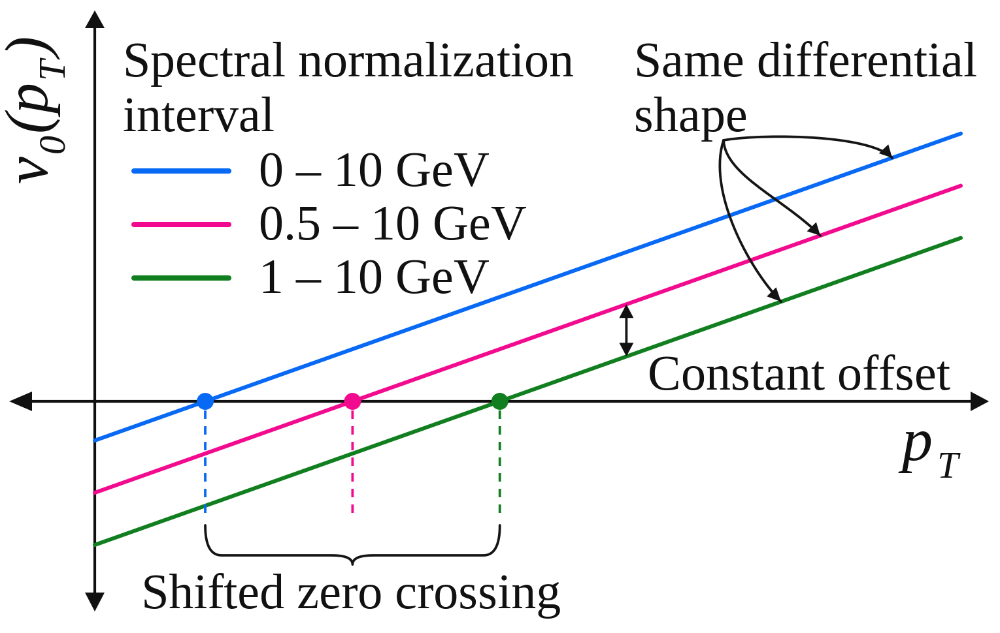

::: {.project-meta}
**Somadutta Bhatta, Aman Dimri, Jiangyong Jia**

*Nuclear Science and Techniques* **37**, 163 (2026)
:::

::: {.project-links}
[NST][journal]{.btn .btn-primary .icon-link .icon-journal}
[arXiv][arxiv]{.btn .btn-outline-primary .icon-link .icon-preprint}
[QM 2025 Poster](posters/qm-2025.qmd){.btn .btn-outline-primary .icon-link .icon-poster}
:::

## Overview

The differential radial-flow observable $v_0(p_T)$ measures how fluctuations of
the particle spectrum at a given transverse momentum correlate with event-by-event
changes in the mean transverse momentum, $[p_T]$. Its momentum-dependent shape
can provide information about collective radial expansion and the transport
properties of the quark-gluon plasma (QGP). But the way a spectrum is normalized,
or the way events are classified by activity, can also affect the numerical value
of the observable.

This project addresses a central interpretational question: **which features of
$v_0(p_T)$ reflect the underlying dynamics, and which depend on analysis
conventions?** Using analytical relations and HIJING simulations, we show that
different spectral-normalization ranges and centrality estimators can produce a
**constant vertical offset** in $v_0(p_T)$ without changing its dependence on
$p_T$. The location where the curve crosses zero is therefore not an invariant
measure of radial-flow dynamics. The robust information resides in its
differential shape, or equivalently in its derivative with respect to $p_T$.

## Analysis

### What does differential radial flow measure?

An event contains a transverse-momentum spectrum $N(p_T)$, whose integral gives
the total number of particles $N$. We can separate its overall normalization
from its momentum-dependent shape by writing

$$
N(p_T)=N\,n(p_T),\qquad \int n(p_T)\,dp_T=1.
$$

The normalized spectrum $n(p_T)$ describes how the particle yield is distributed
in transverse momentum, while $N$ describes the global multiplicity. A change in
radial expansion typically changes the *shape* of the spectrum: stronger radial
flow produces a flatter distribution and a larger event-wise mean $[p_T]$. The
observable $v_0(p_T)$ quantifies the correlation of local spectral fluctuations
with those of $[p_T]$.

The distinction between normalization and shape is essential. In real analyses,
particles are measured over finite momentum intervals, and multiplicity still
fluctuates among events selected within the same centrality bin. An observed
change in $v_0(p_T)$ need not therefore imply a change in the underlying
radial-flow response.

### How global multiplicity creates an offset

For small correlated fluctuations, the spectrum can be decomposed to leading
order as

$$
\delta N(p_T)\simeq
\langle n(p_T)\rangle\,\delta N
+\langle N\rangle\,\delta n(p_T).
$$

The first term represents a global change in particle number, whereas the second
captures a change in the normalized spectral shape. A differential observable
constructed from the unnormalized spectrum $N(p_T)$ therefore contains a
multiplicity contribution in addition to the shape contribution measured from
$n(p_T)$.

The two definitions, denoted $v_0'(p_T)$ and $v_0(p_T)$, obey the approximate
relation

$$
\Delta v_0\equiv v_0'(p_T)-v_0(p_T)
\simeq \rho(N,[p_T])\frac{\sigma_N}{\langle N\rangle},
$$

where $\rho(N,[p_T])$ is the correlation coefficient between multiplicity and
mean transverse momentum, and $\sigma_N$ is the standard deviation of $N$.
Crucially, the right-hand side is **independent of $p_T$**. Residual volume or
centrality fluctuations thus displace the entire curve rather than changing its
shape. The relation is derived under the small-correction approximations
appropriate to narrow event-activity selections.

### The ambiguity introduced by a finite normalization range

Normalizing the spectrum does not completely remove the ambiguity, because the
normalization itself depends on the accepted momentum interval. Define
$N_R=\int_R N(p_T)\,dp_T$ and $n_R(p_T)=N(p_T)/N_R$ for a chosen range $R$.
Even at fixed total multiplicity, $N_R$ can fluctuate as particles enter or
leave the selected interval. Changing $R$ therefore changes the residual
multiplicity contribution to $v_0(p_T)$.

::: {#fig-nst-offset}
{fig-alt="Three parallel differential radial-flow curves for different spectral-normalization intervals, with distinct zero crossings and the same momentum-dependent shape." width=95%}

Schematic of the constant-offset result. Spectral normalization over 0-10,
0.5-10, or 1-10 GeV changes the vertical position and zero crossing of
$v_0(p_T)$ while preserving its differential shape. The drawing illustrates
the interpretation; it is not a plot of HIJING output.
:::

This explains why a zero crossing near the ensemble mean $p_T$ is not a unique
dynamical scale: changing the normalization interval can move the crossing even
when the same underlying spectral fluctuations are being studied.

### Testing the argument with HIJING

We tested these relations in Pb+Pb events generated with HIJING, which provides
a useful non-collective baseline rather than a hydrodynamic description of
radial flow. The study varied the event-activity estimator, the momentum range
used to normalize the spectrum, and the reference momentum interval used to
define $[p_T]$. The correlations were constructed using separated subevents to
reduce short-range biases and to test the expected multiplicity-dependent
contributions.

The results support the analytical picture. Changing the event-activity
definition causes substantial shifts for the observable constructed from the
unnormalized spectrum; using the normalized spectrum or subtracting the
predicted global-multiplicity contribution largely removes those shifts.
Changing the spectral-normalization interval also displaces the curves, and the
calculated correction brings them into close agreement. The corresponding
comparisons are shown in [the article's results figures][arxiv-html].

The reference-$p_T$ dependence of the HIJING results additionally reveals
non-flow contributions, especially at high $p_T$. These effects should not be
confused with the constant baseline ambiguity: they can alter the
momentum-dependent behavior itself. HIJING is therefore used here to separate
methodological and non-flow effects, **not as evidence for collective expansion**.

### Why the zero crossing is not the physical observable

The measured $v_0(p_T)$ may be negative at low momentum and positive at higher
momentum, with a zero crossing between the two. That crossing is visually
convenient, but its location depends on the vertical baseline. Since changing
analysis conventions can modify the baseline without modifying the physical
spectral-shape response, the crossing point alone is not a reliable dynamical
scale.

Instead, a common additive offset cancels from any difference between two
momentum points,

$$
\bigl[v_0(p_{T,1})+C\bigr]-\bigl[v_0(p_{T,2})+C\bigr]
=v_0(p_{T,1})-v_0(p_{T,2}),
$$

and from the derivative

$$
v_{0s}(p_T)\equiv\frac{d v_0(p_T)}{dp_T}.
$$

These shape-sensitive quantities avoid the normalization ambiguity. The
derivative is proposed as a useful alternative observable; the paper does not
claim that the derivative has already been measured experimentally.

### Implications for experimental comparisons

Different experiments use different detector acceptances, momentum cuts,
spectrum-normalization conventions, and event-activity selections. Directly
comparing the absolute positions or zero crossings of their $v_0(p_T)$ curves
can therefore be misleading. A meaningful comparison should first place the
measurements on a common normalization convention or align their baselines,
then compare their $p_T$ dependence.

This distinction is especially important when using differential radial flow to
constrain the QGP's transport properties. A model that reproduces the slope and
curvature but differs by an additive offset need not have an incorrect dynamical
response. Conversely, agreement in the zero-crossing position alone does not
establish agreement in the physical spectral-shape fluctuations.

## My Contribution

I proposed the **constant-offset interpretation** of differential radial-flow
curves obtained with different momentum ranges and analysis conventions. I also
derived the analytical relations connecting global multiplicity fluctuations to
the displacement of $v_0(p_T)$, providing the basis for the paper's interpretation
and its HIJING-based validation. This work helped distinguish robust
momentum-dependent physics from normalization-dependent features of the
observable.

## Connection to the ATLAS Radial-Flow Measurement

This study complements the ATLAS measurement that established long-range
correlations, factorization, and a common differential response shape for radial
flow in Pb+Pb collisions. The ATLAS work provides experimental evidence for
collectivity; the present study explains how residual multiplicity fluctuations
and normalization choices affect the interpretation of the differential
observable. Together, they clarify what should be compared when using
$v_0(p_T)$ to study the collective medium.

::: {.project-links}
[Related Project](../radial-flow-collectivity/index.qmd){.btn .btn-outline-primary .icon-link .icon-project}
[QM 2025 Poster](posters/qm-2025.qmd){.btn .btn-outline-primary .icon-link .icon-poster}
:::

## Broader Implications

The broader lesson is that a differential observable can contain both dynamical
information and an analysis-dependent baseline. Recognizing which features are
invariant under changes of normalization makes comparisons between experiments
and models more reliable. For radial flow, this focuses attention on the shape of
$v_0(p_T)$ as the part that can be used to study the medium's response and,
ultimately, constrain properties such as bulk viscosity.

[journal]: https://doi.org/10.1007/s41365-026-01998-z
[arxiv]: https://arxiv.org/abs/2504.20008
[arxiv-html]: https://arxiv.org/html/2504.20008/
