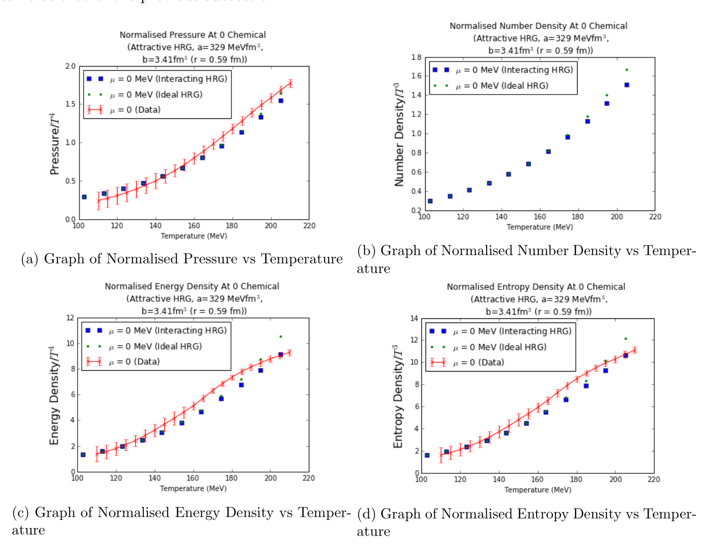
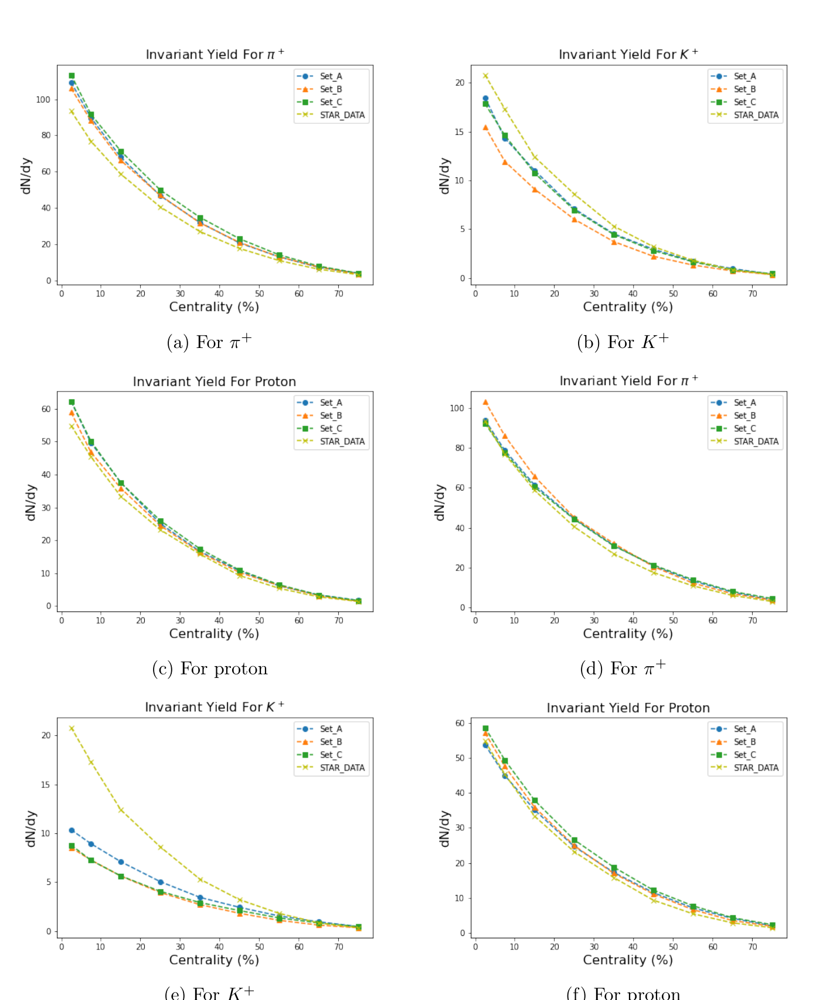
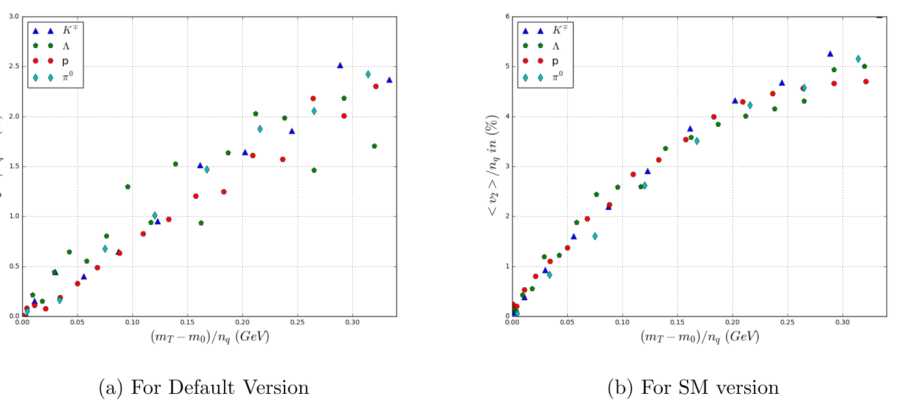
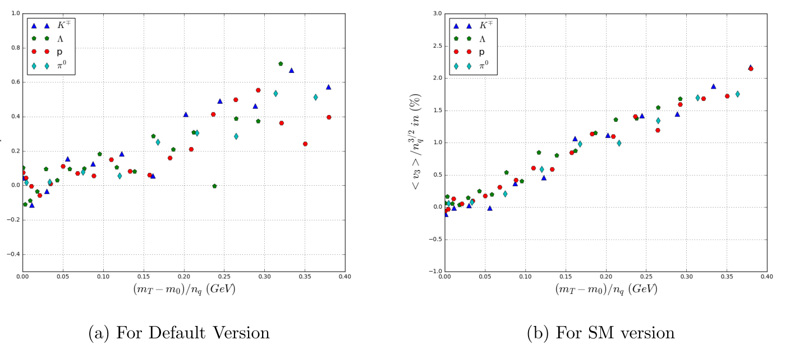
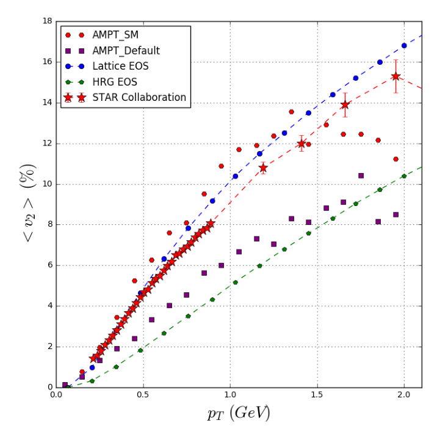

::: {.project-meta}
**Master of Science (Physics) Thesis**  
National Institute of Science Education and Research (NISER), Bhubaneswar, India  
July 2021 | Supervisor: **Prof. Bedangadas Mohanty**
:::

::: {.project-links}
[Read Full Thesis (PDF)](files/masters-thesis.pdf){.btn .btn-outline-primary target="_blank" rel="noopener" .icon-link .icon-report}
:::

## Overview

My Master's thesis brought together two complementary parts of my training: reconstructing the mathematical foundations of statistical mechanics and applying statistical and dynamical models to high-energy nuclear collisions. I began by working through the theory of quantum gases, their thermodynamics, and systematic treatments of interactions. I then used that framework to study hadronic matter, particle production, and collective flow in relativistic heavy-ion collisions.

The initial chapters were primarily an exercise in understanding established physics at the level of derivations. Working principally from Kerson Huang's *Statistical Mechanics* [@huang1987], I developed my own calculations and explanations of the underlying results. These chapters document **independent reconstructions of established derivations**, building the analytical command I wanted before applying the theory. The later chapters applied the framework to the hadron resonance gas (HRG), chemical freeze-out, and comparisons of transport and hydrodynamic calculations with heavy-ion measurements.

## Reconstructing Statistical Mechanics

### From quantum statistics to thermodynamics

I developed the treatments of ideal Fermi and Bose gases starting from quantum-state counting and the grand canonical ensemble. The calculation connects the mean occupation of single-particle states,

$$
\overline{n}(E)=\frac{1}{\exp[\beta(E-\mu)]\pm1},
$$

with macroscopic observables such as pressure, particle density, internal energy, and specific heat. Here the plus sign describes fermions and the minus sign describes bosons. I considered non-relativistic and relativistic regimes, including zero- and finite-temperature limits.

The derivations extended to familiar but instructive examples: blackbody radiation, phonon thermodynamics, and Bose–Einstein condensation. Working through these results established how the same statistical-mechanical formalism describes apparently different physical systems.

### Introducing interactions and approximation schemes

I next studied how the ideal-gas picture changes when particles have interactions or a finite excluded volume. This part developed classical and quantum cluster expansions, virial coefficients, low-temperature treatments of imperfect quantum gases, and the van der Waals approach to the equation of state.

A central lesson was the relationship between microscopic assumptions, approximation schemes, and observable thermodynamic quantities. These mathematical tools prepared the transition from idealized gases to a system containing many hadronic species. The treatment draws on Huang's textbook and, for the nuclear-matter applications, research literature cited in the original thesis.

## Applying Statistical Mechanics to Hadronic Matter

### The hadron resonance gas

The HRG model describes a thermal system using the known hadron spectrum. I compared ideal HRG, excluded-volume HRG, and an interacting van der Waals formulation by calculating thermodynamic quantities and comparing them with lattice-QCD results at zero chemical potential.

The comparisons showed that the treatment of interactions—and whether mesons and baryons are modeled together or as distinct subsystems—substantially affects the predictions. In particular, treating the mesons as ideal while including van der Waals interactions in the baryonic sector improved agreement with the lattice-QCD curves **for the model parameters and thermodynamic range considered in the thesis**.

{#fig-hrg fig-align="center" width="94%" fig-alt="Four-panel plots comparing interacting and ideal hadron-resonance-gas thermodynamic quantities against temperature, with lattice-QCD reference data for the displayed observables."}

### Particle yields and chemical freeze-out

I then investigated particle production in Au+Au collisions using statistical and transport descriptions. With the **THERMUS** thermal-model package, I extracted chemical freeze-out parameters from measured hadron yields and compared the results with those reported by the STAR Collaboration.

I also studied particle-yield predictions from the **AMPT** transport model at $\sqrt{s_{\mathrm{NN}}}=7.7\,\mathrm{GeV}$, contrasting its default and string-melting configurations with the STAR measurements. The model described the pion and proton yields more successfully than the kaon yields in the scenarios examined. This comparison illustrated both the utility and the limits of the model description.

{#fig-particle-yields fig-align="center" width="92%" fig-alt="Six original plots of hadron yields versus collision centrality: three for AMPT default and three for string melting, each compared with STAR data."}

## Collective Flow and Hydrodynamic Evolution

The final research part explored whether collective-flow observables could distinguish the model scenarios used to represent predominantly hadronic and QGP-like evolution. I studied elliptic and triangular flow, $v_2$ and $v_3$, using AMPT calculations and compared elliptic-flow behavior with hydrodynamic simulations employing different equations of state.

One focus was **number-of-constituent-quark (NCQ) scaling**. In the studied AMPT configurations, the string-melting scenario showed approximate NCQ scaling of elliptic flow and a modified scaling behavior for triangular flow, while the default configuration showed weaker scaling. These are **model-dependent results**, supporting the interpretation that the partonic-stage dynamics affect the measured flow patterns rather than providing a universal, model-independent test of QGP formation.

::: {layout-ncol=2}
{#fig-flow-v2 width="100%" fig-alt="Two plots of constituent-quark-scaled elliptic flow versus scaled transverse mass for four hadron species in AMPT default and string-melting scenarios."}

{#fig-flow-v3 width="100%" fig-alt="Two plots of scaled triangular flow versus scaled transverse mass for four hadron species, comparing AMPT default and string-melting scenarios."}
:::

The comparison with hydrodynamic calculations provided a complementary perspective: the calculated elliptic flow depended on the assumed equation of state and on the evolution model, and the scenarios could be examined against STAR measurements.

{#fig-hydro-flow fig-align="center" width="70%" fig-alt="Elliptic flow versus transverse momentum comparing AMPT default, AMPT string melting, lattice-QCD equation-of-state and hadron-resonance-gas equation-of-state scenarios with STAR measurements."}

## What This Thesis Established

The thesis helped me develop a working command of statistical mechanics through detailed derivation, and then put that understanding to use in nuclear-physics calculations. It brought together analytical reasoning, numerical modeling, comparisons with experimental measurements, and the need to interpret results within the assumptions of each model. Those foundations have continued to shape my approach to research in relativistic heavy-ion physics.

**Figure provenance.** The plots shown here are direct reproductions of figures from my 2021 Master's thesis (Figs. 30, 35, 45, 47, and 51), cropped for readability without reconstructing or modifying their numerical content. Their original methods, data sources, and additional references are documented in the full thesis.

## References

The early statistical-mechanics chapters draw primarily on @huang1987. Additional papers, experimental inputs, and model references for the later applications are documented in the original thesis bibliography.

::: {#refs}
:::
