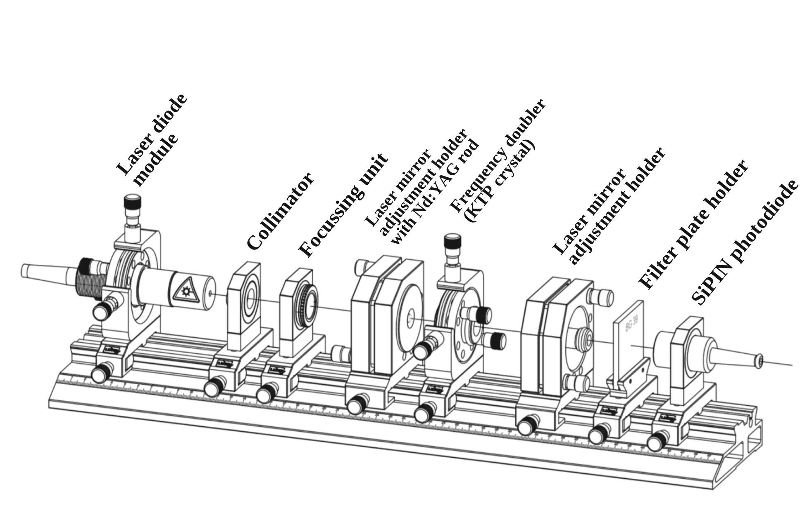
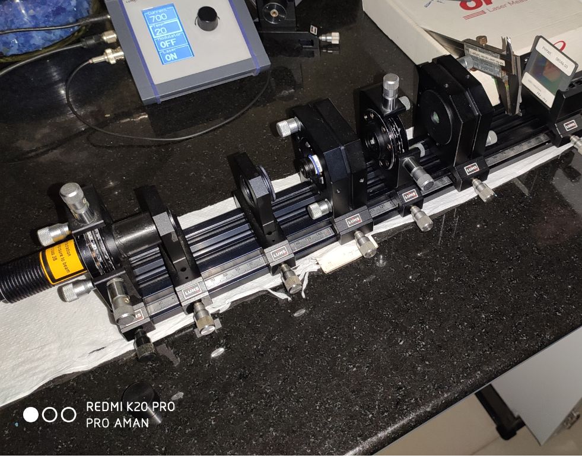
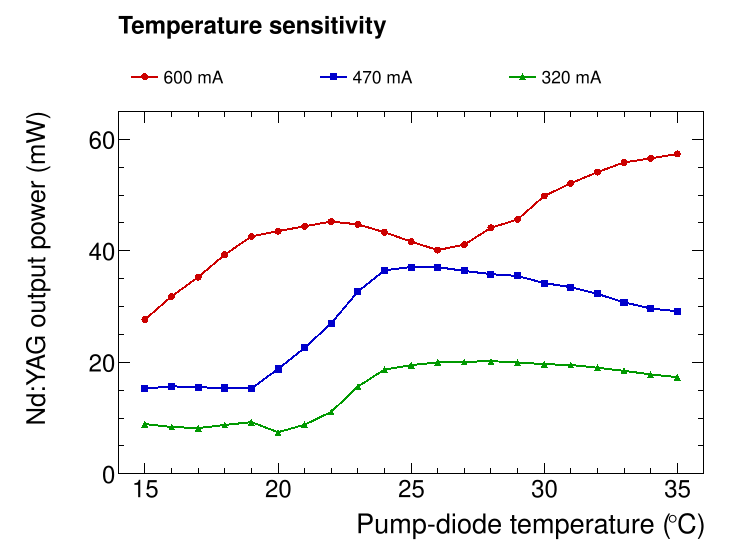
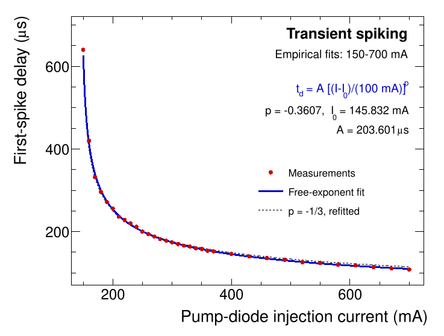
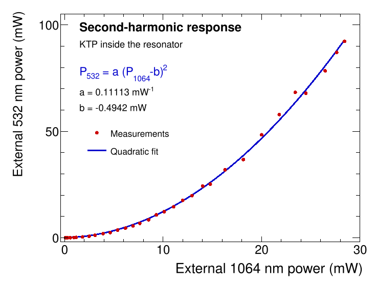

::: {.project-meta}
**Integrated Master's Laboratory Project**  
National Institute of Science Education and Research (NISER)  
Seventh semester
:::

::: {.project-links}
[Full Project Report](files/nd-yag-report.pdf){.btn .btn-outline-primary .icon-link .icon-report}
:::

## Overview

A working laser depends on more than choosing a gain medium. The optical pump,
resonator geometry, and alignment must work together to establish and sustain
lasing. In this Integrated Master's laboratory project, I assembled and aligned
a diode-pumped neodymium-doped yttrium aluminum garnet (Nd:YAG) laser from a
modular optical setup, then investigated its output characteristics and several
features of its dynamics.

The experiments began with the 808 nm pump diode and the generation of 1064 nm
infrared laser light. I then measured lasing thresholds and output power,
examined transient spiking, and used a potassium titanyl phosphate (KTP)
crystal to generate green light at 532 nm through second-harmonic generation.
Finally, I studied the transverse intensity patterns of the frequency-doubled
beam. The work combined patient optical alignment with quantitative measurements
and numerical analysis of the results.

## Experimental Setup

The system used a temperature-controlled diode laser to optically pump a
Nd:YAG crystal. Collimating and focusing optics directed the pump light into
the gain medium, which formed part of an adjustable resonator. The output was
characterized using an optical power meter, a photodiode detector, and an
oscilloscope. For frequency doubling, a KTP crystal was introduced into the
resonator to convert part of the 1064 nm radiation into 532 nm light.

{#fig-ndyag-apparatus fig-align="center" width="94%" fig-alt="Original Leybold perspective optical-bench drawing with labels for the diode laser, collimator, focusing unit, Nd:YAG rod mirror-adjustment holder, KTP frequency doubler, second laser mirror adjustment holder, filter plate holder, and SiPIN photodiode."}

{#fig-ndyag-laboratory-photo fig-align="center" width="65%" fig-alt="Original laboratory photograph of the assembled Nd:YAG laser components and supporting optical mounts."}

A major practical challenge was achieving a common optical axis through the
pump optics, Nd:YAG crystal, and resonator mirrors. The alignment was refined
iteratively until stable laser operation could be obtained.

## Methods

### Aligning and characterizing the laser

We first characterized the pump diode by varying its injection current and
temperature. Absorption measurements through the Nd:YAG crystal helped locate
a favorable pump-wavelength region; the report discusses an absorption feature
consistent with pumping near 808.4 nm, while noting that the limited temperature
range did not establish an unambiguous spectral assignment.

After aligning the resonator, we measured the infrared output power as a
function of pump-diode current. These measurements were used to identify the
onset of lasing and its approximately linear operating region. Output-power
measurements at different diode temperatures also illustrated the sensitivity
of the laser to pump wavelength and optical alignment.

### Measuring the excited-state lifetime and transient response

We monitored the photodetector signal after changing the pumping conditions.
Assuming an exponential decay,

$$
V(t) = V_0 e^{-t/\tau},
$$

we estimated the lifetime of the Nd:YAG $^4F_{3/2}$ metastable level using the
time at which the measured signal fell to $V_0/e$. Ten repetitions were used
to estimate its mean and spread. The report notes a photodetector response
time of approximately $10\ \mu\mathrm{s}$ for the selected gain setting.

In pulsed operation, we also recorded the time between turning on the pump and
the first large laser-output spike. The relationship between this delay and
pump current was investigated using empirical fits.

### Frequency doubling and beam profiles

To explore nonlinear optical behavior, we inserted a KTP frequency-doubling
crystal inside the resonator. We observed green second-harmonic light at 532 nm
and measured how its external output power changed with the measured
fundamental output. Finally, we recorded the shapes of several transverse
laser modes and compared their intensity distributions with expected beam
profiles.

## Results and Interpretation

### Lasing thresholds and excited-state lifetime

The two stages of the optical system showed distinct output-power responses to
pump-diode current. The measured thresholds and the excited-state lifetime are
summarized below.

| Measurement | Reported result |
|:------------|----------------:|
| Pump-diode lasing threshold | $144.004 \pm 1.756\ \mathrm{mA}$ |
| Nd:YAG lasing onset, expressed as pump-diode current | $140.426 \pm 4.218\ \mathrm{mA}$ |
| Nd:YAG $^4F_{3/2}$ lifetime | $263.5\ \mu\mathrm{s}$ (sample standard deviation: $10.5\ \mu\mathrm{s}$) |

The lifetime was estimated from ten oscilloscope measurements. The stated
$10.5\ \mu\mathrm{s}$ characterizes the spread of those measurements, rather
than a complete uncertainty budget; the detector response time was assessed
separately in the report. The Nd:YAG output became approximately linear over
an intermediate current range and showed signs of saturation at higher pump
currents.

{#fig-ndyag-output fig-align="center" width="94%" fig-alt="Two panels with measured diode-pump output and Nd:YAG 1064-nanometer output versus pump-diode injection current, with dashed markers at the reported lasing thresholds."}

### Pump-temperature sensitivity

The Nd:YAG output also depended on the diode temperature, which changes the
pump wavelength and its overlap with the crystal absorption spectrum. The
measured dependence varied with the fixed injection current, as illustrated
below. The lines connect measured points and do not represent an additional
fit or a temperature-to-wavelength calibration.

{#fig-ndyag-temperature fig-align="center" width="82%" fig-alt="Three measured power-versus-temperature series at pump-diode currents of 320, 470, and 600 milliamperes."}

### Transient spiking

When the pump was switched on, the laser output did not immediately settle to
its steady-state value. Instead, a large initial spike appeared after a
measurable delay. The report found that, over the measured current range, the
delay was approximately described by

$$
t_{\mathrm{delay}} \propto (I-I_{\mathrm{th}})^{-1/3},
$$

where $I$ is the pump-diode injection current and $I_{\mathrm{th}}$ is a
threshold determined by the empirical fit. This behavior illustrated the
transient response of the coupled population inversion and intracavity light
field.

{#fig-ndyag-spiking fig-align="center" width="83%" fig-alt="Measured first-spike delay decreases with increasing pump current. A new free-exponent fit gives a power-law exponent of minus 0.3607, compared with a separate fitted fixed-minus-one-third curve."}

For these reconstructed plots, a **new unweighted fit** gives an empirical
exponent of approximately $-0.361$ and an onset parameter
$I_0\approx145.8\ \mathrm{mA}$. These are fit results from the tabulated
spiking data, distinct from the lasing thresholds reported above. The
$-1/3$ behavior remains a useful approximation over the measured current
range, rather than an exact relation.

### Second-harmonic generation

With the KTP crystal inside the resonator, the infrared output at 1064 nm
produced visible green light at 532 nm. In this setup, the green signal was
not observed when the crystal was placed outside the resonator, consistent
with the importance of the higher intracavity intensity for this nonlinear
process. The measured output powers followed an approximately quadratic
relationship,

$$
P_{2\omega} \propto P_{\omega}^{2},
$$

as expected in the regime considered in the report. Because the fundamental
and second-harmonic powers were measured at different outputs of the optical
system, their numerical ratio should not be treated directly as a conversion
efficiency.

{#fig-ndyag-shg fig-align="center" width="83%" fig-alt="Measured external second-harmonic output power increases approximately quadratically with measured fundamental output power; a smooth blue quadratic fit is superimposed."}

The fitted quadratic describes the tabulated external powers. Its parameters
were newly estimated from the original table; they should not be interpreted
as an independently calibrated optical conversion efficiency or an observed
zero-power offset.

### Transverse laser modes

The frequency-doubled output also exhibited distinct transverse intensity
patterns. The fundamental $\mathrm{TEM}_{00}$ mode appeared as a single bright
spot, with an approximately Gaussian transverse profile. Higher-order modes
showed multiple lobes and nodes; the $\mathrm{TEM}_{10}$ pattern provides a
clear two-lobed example.

![Illustrative transverse laser modes of the frequency-doubled Nd:YAG laser. Each pair shows a representative beam pattern (left) and an idealized three-dimensional intensity surface (right): **(a,b)** $\mathrm{TEM}_{00}$; **(c,d)** $\mathrm{TEM}_{10}$; **(e,f)** $\mathrm{TEM}_{20}$; **(g,h)** $\mathrm{TEM}_{02}$; **(i,j)** $\mathrm{TEM}_{30}$; **(k,l)** $\mathrm{TEM}_{22}$. The images are illustrative, enhanced for clarity, and are not the original measured intensity profiles. Experimental photographs and profiles appear in the laboratory report.](images/transverse-modes.webp){#fig-ndyag-modes fig-align="center" width="100%" fig-alt="Six pairs of illustrative green laser transverse modes and idealized intensity surfaces: TEM00, TEM10, TEM20, TEM02, TEM30 and TEM22."}

[Enlarged Figure](images/transverse-modes.webp){#ndyag-enlarge-modes .btn .btn-outline-primary target="_blank" rel="noopener noreferrer" .icon-link .icon-expand}

## Conclusions

The project connected the construction and alignment of an optical instrument
with measurements of the physics it makes accessible. We established Nd:YAG
laser operation, measured its power characteristics and metastable-state
lifetime, observed transient spiking, generated a visible second harmonic,
and investigated transverse beam modes. It was a practical introduction to
how sensitive experimental systems are assembled, calibrated, and understood
through careful measurement and analysis.
