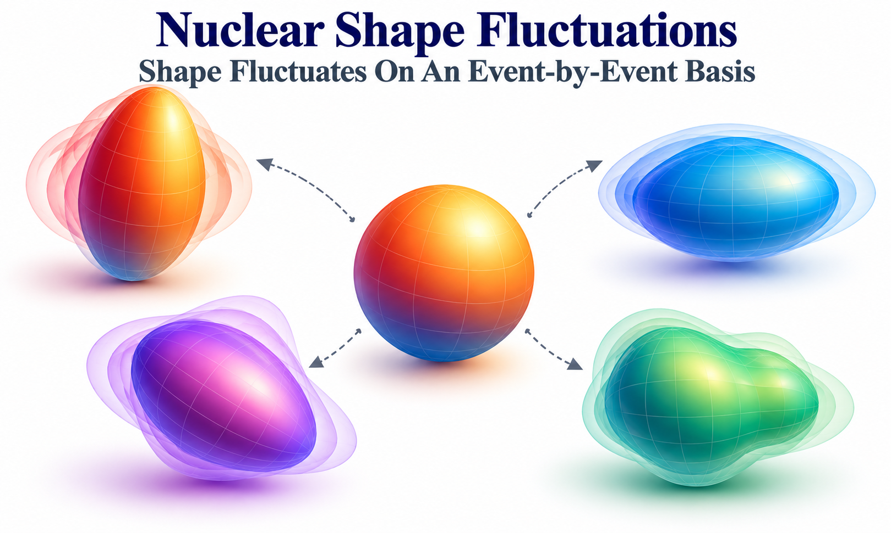

::: {.project-meta}
**Aman Dimri, Somadutta Bhatta, Jiangyong Jia**

*The European Physical Journal A* **59**, 45 (2023)
:::

::: {.project-links}
[EPJ A][journal]{.btn .btn-primary .icon-link .icon-journal}
[arXiv][arxiv]{.btn .btn-outline-primary .icon-link .icon-preprint}
[INT-23-1a Talk](talks/int-23-1a.qmd){.btn .btn-outline-primary .icon-link .icon-talk}
:::

## Overview

Nuclei are often described by a single average shape, such as spherical, prolate, or
oblate. In reality, the nuclear wave function may contain a distribution of shapes:
the magnitude of the deformation and its triaxiality can both fluctuate. High-energy
heavy-ion collisions offer a complementary way to investigate these fluctuations.
The initial positions of the participating nucleons determine the geometry of the
matter created in the collision, which in turn influences the subsequent collective
expansion.

This project asks **how fluctuations of intrinsic nuclear shape affect the initial
collision geometry, and whether the average deformation can be separated from its
fluctuations**. Using analytical estimates and Monte Carlo Glauber simulations, we
study two initial-state observables: elliptic eccentricity, $\varepsilon_2$, and the
inverse transverse size, $d_\perp$. They are related, respectively, to elliptic
flow and event-by-event variations of mean transverse momentum. We find that
fluctuations of deformation magnitude modify their variances and higher-order
cumulants, while fluctuations of triaxiality progressively wash out the distinction
between prolate and oblate shapes.

## Analysis

### Beyond a fixed nuclear shape

A quadrupole-deformed nucleus can be characterized by two parameters: $\beta$, the
magnitude of its deformation, and $\gamma$, its triaxiality. In this convention,
$\gamma=0$ describes a prolate shape, $\gamma=\pi/3$ an oblate shape, and
$\gamma=\pi/6$ a maximally triaxial shape. A conventional fixed-shape calculation
assigns a constant pair $(\beta,\gamma)$ to each nucleus and averages only over
its spatial orientation.

Here we additionally allow the nuclear shape itself to fluctuate. The model samples
$\beta$ and $\gamma$ from distributions characterized by their means
$(\bar\beta,\bar\gamma)$ and widths $(\sigma_\beta,\sigma_\gamma)$. This
separates two physically different questions: *what is the average nuclear shape?*
and *how broadly does the nucleus fluctuate around that shape?* The collision
observables need not respond to these two properties in the same way.

::: {#fig-fluctuating-nuclear-shapes}
{fig-alt="Schematic illustration of a reference nucleus surrounded by configurations with different intrinsic shapes, emphasizing event-by-event nuclear-shape fluctuations." width=78%}

Schematic representation of nuclear-shape fluctuations. Different intrinsic
configurations contribute to the event-by-event distribution of collision
geometries. This is a conceptual illustration, not a Glauber-model result.
:::

### Connecting nuclear shape to the collision geometry

For each event, the positions of the participants define the complex elliptic
eccentricity and an inverse-size measure,

$$
\boldsymbol{\varepsilon}_2
=-\frac{\langle r_\perp^2e^{2i\phi}\rangle_{\mathrm{part}}}
{\langle r_\perp^2\rangle_{\mathrm{part}}},
\qquad
d_\perp=\sqrt{\frac{N_{\mathrm{part}}}
{\langle r_\perp^2\rangle_{\mathrm{part}}}}.
$$

Here the averages are over participating nucleons in a single event.
$\varepsilon_2=|\boldsymbol{\varepsilon}_2|$ measures the ellipticity of the
initial transverse distribution, whereas $d_\perp$ increases when the overlap
region becomes more compact at comparable participant number. In a collective
response picture, $v_2\simeq\kappa_2\varepsilon_2$ and fluctuations of
$d_\perp$ are related to variations of radial expansion and $[p_T]$. These are
connections to final-state observables; **the calculations in this paper are
performed at the initial-state level**, rather than with full hydrodynamic evolution.

### Modeling event-by-event deformation fluctuations

The study uses a deformed Woods-Saxon nucleon distribution and Monte Carlo Glauber
simulations of ultra-central $^{238}$U+$^{238}$U collisions at zero impact
parameter. This setting suppresses the geometric anisotropy associated with a
nonzero impact parameter and makes the effects of intrinsic deformation easier to
isolate. For each nucleus, the model samples its deformation parameters and a
random orientation before computing participant positions and the corresponding
$\varepsilon_2$ and $d_\perp$.

Analytical leading-order relations guide the interpretation, while extensive
nucleon-Glauber calculations quantify higher-order corrections. A constituent-quark
Glauber calculation provides a separate check of the qualitative trends. This
combination lets us distinguish robust dependencies on the deformation moments
from details of the initial-state model.

### What do the higher-order observables reveal?

To leading order, the deformation-dependent part of the second moments of
$\varepsilon_2$ and $d_\perp$ is governed by

$$
\langle\beta^2\rangle=\bar\beta^2+\sigma_\beta^2.
$$

Consequently, a two-particle observable alone cannot generally determine whether
a larger fluctuation signal comes from a larger average deformation or from
stronger event-by-event fluctuations of that deformation. Higher-order
observables offer complementary sensitivity. Mixed three-particle correlations
between eccentricity and inverse size, and the third moment of inverse-size
fluctuations, depend at leading order on
$\langle\beta^3\cos(3\gamma)\rangle$. Four-particle eccentricity cumulants
also probe $\langle\beta^4\rangle$ and combinations of lower moments. The
higher moments therefore carry information not contained in the variance alone.

In particular, a wider distribution in $\beta$ modifies not only the variance but
also the skewness and kurtosis of the initial-state observables. The numerical
study demonstrates where leading-order expectations work and where higher-order
contributions become important. These effects are presented in detail in
[the published paper][arxiv-html].

### Why triaxiality fluctuations matter

The response to $\gamma$ fluctuations has a distinct pattern. For a Gaussian
distribution of $\gamma$,

$$
\langle\cos(3\gamma)\rangle
=e^{-9\sigma_\gamma^2/2}\cos(3\bar\gamma).
$$

Thus, increasing $\sigma_\gamma$ suppresses the leading term that distinguishes
prolate and oblate configurations in the three-particle observables. In the
large-fluctuation limit of the model, their predictions converge toward those for
a rigid triaxial nucleus. A nucleus whose triaxiality fluctuates widely may
therefore look quite different from a nucleus with the same *mean* shape held
fixed. This makes it essential to account for shape fluctuations when
interpreting flow-based nuclear-structure constraints.

### Can the mean deformation and its fluctuations be separated?

A central result of the paper is a strategy for constraining both
$\bar\beta$ and $\sigma_\beta$. Since the second eccentricity moment primarily
measures $\langle\beta^2\rangle$, we examined a combination of the second and
fourth moments,

$$
F_K=\langle\varepsilon_2^4\rangle
-K\langle\varepsilon_2^2\rangle^2,
$$

with $K$ chosen to minimize sensitivity to $\sigma_\beta$. In the nucleon-Glauber
study, an optimized value near $K=2.54$ produces a quantity that depends mainly
on $\bar\beta^4$. The mean deformation inferred in this way can then be combined
with the second moment to constrain the fluctuation width.

This is a **model-tested method**, not a model-independent determination of
nuclear deformation from experimental data. Its separation power becomes weaker
when the fluctuations are comparable to or larger than the mean deformation, and
quantitative application to measured flow requires control of the subsequent
hydrodynamic response. Nevertheless, the construction illustrates why combining
cumulants of different orders is more informative than relying on one observable.

## My Contribution

As the first author, I investigated the effects of quadrupole-deformation and
triaxiality fluctuations on collision geometry using Monte Carlo simulations. My
work focused on the distributions and higher-order correlations of
$\varepsilon_2$ and $d_\perp$, including how different moments respond to the
mean nuclear shape and its event-by-event fluctuations. The study also developed
and tested combinations of eccentricity moments that can help separate the
average deformation from its fluctuation width.

## Broader Implications

The work connects intrinsic nuclear-structure fluctuations with the collective
observables of relativistic heavy-ion collisions. Because elliptic flow and mean
transverse momentum respond to different aspects of the same initial geometry,
their moments and correlations offer complementary constraints on nuclear shape.
The central lesson is that extracting a nuclear deformation from high-energy
collisions requires accounting for **both its mean and its fluctuations**.

This approach complements traditional nuclear-structure measurements and motivates
combined studies of elliptic flow, radial-flow fluctuations, and higher-order
cumulants across collision systems. Future comparisons with full hydrodynamic
calculations and data can test how much of the initial-state sensitivity survives
into experimentally measured observables. A complementary experimental example is
the ATLAS O+O and Ne+Ne flow measurement, which tests the sensitivity of
collective flow to the intrinsic shapes of light nuclei.

::: {.project-links}
[Oxygen-Neon Nuclear Structure](../oxygen-neon-nuclear-structure/index.qmd){.btn .btn-outline-primary .icon-link .icon-project}
:::

## Related Presentations

The study was presented through the following talks and posters:

::: {.project-links}
[APS DNP 2022 Talk](talks/aps-dnp-2022.qmd){.btn .btn-outline-primary .icon-link .icon-talk}
[INT-23-1a Talk](talks/int-23-1a.qmd){.btn .btn-primary .icon-link .icon-talk}
[SQM 2022 Poster](posters/sqm-2022.qmd){.btn .btn-outline-primary .icon-link .icon-poster}
[QM 2023 Poster](posters/qm-2023.qmd){.btn .btn-outline-primary .icon-link .icon-poster}
:::

[journal]: https://doi.org/10.1140/epja/s10050-023-00965-1
[arxiv]: https://arxiv.org/abs/2301.03556
[arxiv-html]: https://arxiv.org/html/2301.03556v2
