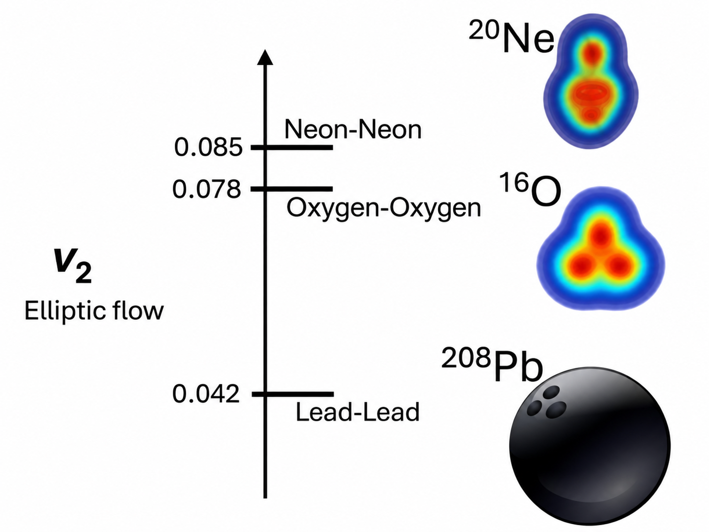

::: {.project-meta}
**ATLAS Collaboration**

*Physical Review C* **113**, 045205 (2026)
:::

::: {.project-links}
[PRC][journal]{.btn .btn-primary}
[arXiv][arxiv]{.btn .btn-outline-primary}
[ATLAS Physics Briefing][atlas-briefing]{.btn .btn-outline-primary}
:::

::: {.project-plenary}
**Plenary Talk — Initial Stages 2025**

Presented the first ATLAS results from the O+O and Ne+Ne collision program at
Initial Stages 2025 in Taipei, Taiwan, on September 11, 2025.

[Initial Stages 2025 Talk](talks/initial-stages-2025.qmd){.btn .btn-outline-primary}
:::

## Overview

The shape of a colliding nucleus influences the geometry of the matter created in a
high-energy nuclear collision. As this matter expands, its initial spatial anisotropy
is converted into an anisotropy in the directions of the produced particles. Collective
flow can therefore reveal properties of the incoming nuclei, connecting measurements
of the quark–gluon plasma (QGP) with questions traditionally addressed by nuclear-structure physics.

This project studies that connection using the first ATLAS measurements of azimuthal
flow in $^{16}$O+$^{16}$O and $^{20}$Ne+$^{20}$Ne collisions at
$\sqrt{s_{\mathrm{NN}}}=5.36$ TeV, recorded at the LHC in 2025. Oxygen and neon are
similar in size but have different predicted intrinsic shapes, making their comparison
particularly sensitive to nuclear geometry. The central result is an enhancement of
elliptic flow, $v_2$, in Ne+Ne relative to O+O collisions, consistent with the
pronounced prolate deformation of the neon nucleus. The four-particle cumulant
measurements provide especially strong sensitivity to this difference.

## Analysis

### Why compare oxygen and neon?

In non-central nuclear collisions, the offset between the two colliding nuclei
produces an almond-shaped overlap region. In the most central collisions, this
impact-parameter contribution becomes small, and fluctuations and the intrinsic
shapes of the nuclei play a larger role. Light-ion collisions are consequently a
useful setting in which to study the influence of nuclear structure on collective
motion.

Nuclear-structure calculations describe $^{16}$O as approximately spherical, with
possible tetrahedral $\alpha$-cluster correlations, whereas $^{20}$Ne is predicted
to have a pronounced prolate, or elongated, configuration. The latter is often
described as a *bowling-pin-like* shape. Because the two nuclei have comparable
masses, taking ratios of their flow measurements reduces several shared size-dependent and experimental effects, making the differences more sensitive to the
initial nuclear geometry.

::: {#fig-light-nuclear-geometry}
{fig-alt="Schematic nuclear-density shapes for neon, oxygen, and lead beside the ordering of their elliptic flow in central collisions." width=82%}

Illustration of the contrasting nuclear shapes and the ordering of measured elliptic
flow in central Ne+Ne, O+O, and Pb+Pb collisions. The nuclear density profiles are
schematic; the corresponding experimental comparison is discussed in the
[ATLAS Physics Briefing][atlas-briefing].
:::

### From initial geometry to anisotropic flow

The final-state azimuthal distribution is characterized by the flow coefficients
$v_n$, which quantify the Fourier harmonics of particle emission. In a simple
hydrodynamic response picture, the elliptic and triangular harmonics are related
to the corresponding initial-state eccentricities through

$$
v_n \simeq \kappa_n\varepsilon_n, \qquad n=2,3,
$$

where $\varepsilon_n$ describes the initial spatial anisotropy and $\kappa_n$
encodes the collective response. This relation is approximate, but it illustrates
the basic principle: differences in the intrinsic geometry of oxygen and neon can
survive the expansion and appear as differences in the measured $v_n$. Elliptic
flow, $v_2$, is especially sensitive to an elongated initial configuration, while
triangular flow, $v_3$, provides complementary information about event-by-event
geometry fluctuations.

### Measuring flow and its fluctuations

ATLAS measured the flow harmonics $v_2$, $v_3$, and $v_4$ as functions of
transverse momentum, charged-particle multiplicity, and collision centrality. The
analysis combines two complementary methods. Two-particle azimuthal correlations,
with a template-fit subtraction, measure the flow harmonics while reducing the
contributions of jets and other non-flow correlations. Four-particle subevent
cumulants use higher-order particle correlations to suppress non-flow and probe
different moments of the event-by-event flow distribution.

The four-particle cumulant is defined by

$$
c_n\{4\}=\langle\!\langle\{4\}_n\rangle\!\rangle
-2\langle\!\langle\{2\}_n\rangle\!\rangle^2,
\qquad v_n\{4\}=\bigl(-c_n\{4\}\bigr)^{1/4},
$$

where $\{2\}_n$ and $\{4\}_n$ are the two- and four-particle azimuthal
correlations and the double brackets denote ensemble averages;
$v_n\{4\}$ is defined when $c_n\{4\}<0$. Unlike the two-particle measurement,
which is sensitive to the mean squared flow magnitude, the four-particle
measurement also constrains the structure of its event-by-event fluctuations.
Comparing $v_n\{2\}$ and $v_n\{4\}$ thus provides additional information about
the initial nuclear geometry.

### Experimental signatures of collectivity

Both O+O and Ne+Ne collisions exhibit the hierarchy $v_2>v_3>v_4$. The measured
$v_2(p_{\mathrm{T}})$ rises at low transverse momentum and decreases after a
maximum around $2$–$4$ GeV, following trends familiar from larger heavy-ion
systems. These features are consistent with a collective response in the light-ion systems, although their detailed interpretation requires control of non-flow
contributions and initial-state fluctuations.

The difference between the two- and four-particle measurements becomes more
pronounced toward high multiplicity, revealing the increasing relative role of
flow fluctuations in central events. This motivates examining not only the
magnitudes of the individual harmonics but also their ratios between the two
collision systems.

### The nuclear-shape signal in central collisions

The most direct signature comes from the Ne+Ne/O+O ratios of the flow harmonics.
For centralities more peripheral than approximately 10%, the $v_2$ ratios vary
relatively little with centrality. Toward the most central collisions, however,
both the two- and four-particle elliptic-flow ratios increase. **The enhancement
is more pronounced for $v_2\{4\}$**, making the four-particle cumulant comparison
particularly sensitive to the difference in intrinsic nuclear shape.

The triangular-flow measurements provide a useful contrast. The two-particle
$v_3$ ratio decreases toward the most central collisions, becoming comparable
between Ne+Ne and O+O in the 0–1% interval. Together, these observations favor
an interpretation in which neon's elongated geometry contributes to the enhanced
elliptic response, rather than a uniform increase of all flow harmonics. The multiplicity-dependent and centrality-dependent comparisons are presented
in [Fig. 6][paper-fig6] and [Fig. 7][paper-fig7] of the ATLAS paper, respectively.

### Comparison with nuclear-structure models

The measurements are also compared with hydrodynamic calculations incorporating
microscopic nuclear configurations. Models using nuclear structures from the
projected generator coordinate method, together with different descriptions of
initial energy deposition, reproduce some aspects of the O+O and Ne+Ne systematics
but differ in their ability to describe the centrality dependence. In particular,
the observed central enhancement of the $v_2$ ratio is described more successfully
by the calculation combining nuclear-structure inputs with Trento initial
conditions than by the calculation using IP-Glasma initial conditions.

This comparison illustrates both the value and the challenge of using flow as a
nuclear-structure probe. The data are sensitive to the intrinsic shapes of the
nuclei, but extracting quantitative nuclear-structure constraints also requires
control of the initial-state model and the subsequent hydrodynamic response.

## My Contribution

As a member of the ATLAS primary analysis group, I served as the **main analyst
for the multi-particle cumulant measurements** in O+O and Ne+Ne collisions. This
work supplied the four-particle flow observables that probe event-by-event
fluctuations and give the strongest sensitivity to the nuclear-shape difference
in the elliptic-flow comparison. I also presented the first ATLAS O+O and Ne+Ne
flow results in a plenary talk at Initial Stages 2025.

## Broader Implications

The O+O and Ne+Ne measurements demonstrate how relativistic collisions of light
nuclei can connect two complementary questions: what shapes do nuclei have, and
how does the matter they create respond collectively to those shapes? Comparing
systems with similar size but different intrinsic geometry provides constraints
on nuclear-structure calculations while testing hydrodynamic and initial-state
models in small collision systems.

The pronounced sensitivity of $v_2\{4\}$ also establishes higher-order flow
correlations as an important part of this program. More precise measurements,
together with improved model calculations, may help distinguish the effects of
nuclear deformation, clustering, and event-by-event initial-state fluctuations.

[journal]: https://doi.org/10.1103/xqxz-8bhf
[arxiv]: https://arxiv.org/abs/2509.05171
[atlas-briefing]: https://atlas.cern/Updates/Briefing/Oxygen-Neon-Flow
[paper-fig6]: https://arxiv.org/html/2509.05171#S6.F6
[paper-fig7]: https://arxiv.org/html/2509.05171#S6.F7
