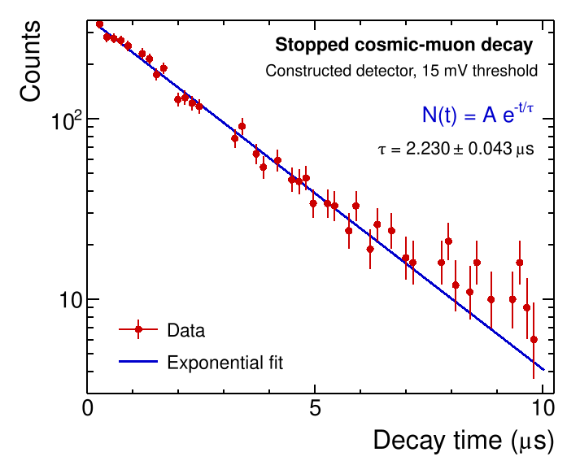
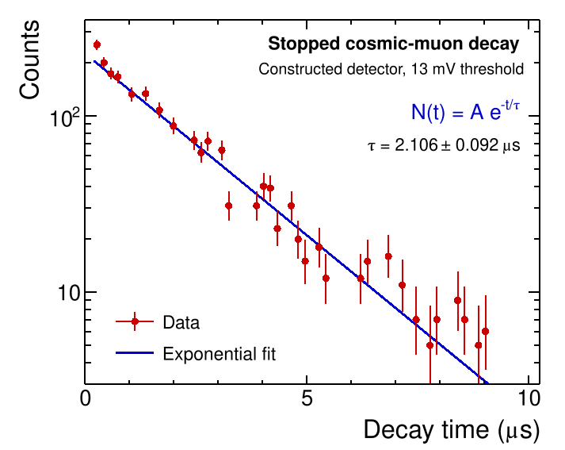

::: {.project-meta}
**Integrated Master's Laboratory Project**  
National Institute of Science Education and Research (NISER)  
Eighth semester | Collaborative project with Divyanshu Gupta
:::

::: {.project-links}
[Full Project Report](files/scintillator-report.pdf){.btn .btn-outline-primary .icon-link .icon-report}
:::

## Overview

A particle detector begins with a physical interaction, but the information we
measure is usually an electrical signal. In this project, I worked with my lab
partner to build a plastic scintillation detector and use it to measure the mean
lifetime of stopped cosmic muons. The aim was to follow the full experimental
process: assembling the detector, establishing that it produced usable signals,
and testing its performance through a quantitative physics measurement.

We constructed a detector based on an EJ-200 plastic scintillator coupled to a
photomultiplier tube (PMT). After verifying its response with an oscilloscope,
we connected it to timing and acquisition electronics, recorded candidate
stopped-muon decay events, and extracted decay lifetimes from exponential fits
using ROOT. We also collected data with an existing laboratory detector for
comparison.

This was a collaborative fourth-year Integrated Master's laboratory project at
NISER, carried out with Divyanshu Gupta. The work combined detector assembly, optical coupling, electronic
signal processing, calibration, and data analysis.

## Experimental Setup

### Turning particle interactions into signals

When an ionizing particle deposits energy in the plastic scintillator, the
material emits a short flash of visible light. The EJ-200 scintillator used in
our detector emits primarily in the blue region, with a reported emission peak
near 425 nm. Photons reaching the PMT release photoelectrons at its photocathode.
A dynode chain amplifies the resulting signal into a voltage pulse that can be
recorded by electronic instruments.

Efficient light collection depends on the construction of the detector as much
as on the choice of scintillating material. Our assembly used several components
with distinct roles:

- **EJ-200 plastic scintillator:** Produced the light signals when particles
  deposited energy in the detector.
- **EJ-510 reflective coating:** Helped redirect scintillation light within the
  scintillator toward the photosensor.
- **Black vinyl wrapping:** Reduced the entry of ambient light into the assembly.
- **EJ-560 silicone optical interface:** Coupled the scintillator optically to
  the PMT.
- **ET-9266B photomultiplier tube:** Converted the collected light into
  measurable electrical pulses.

### Building the detector

We cleaned and prepared the scintillator, applied successive reflective
coatings, and wrapped the coated surfaces to make the assembly light-tight. We
then prepared an acrylic mounting support, coupled the PMT to the scintillator
through the optical interface, and secured the completed assembly. Finally, we
checked the detector output on an oscilloscope before proceeding to the
lifetime measurement.

![**Construction and testing of the scintillation detector:** (a) Preparing the bare scintillator crystal → (b) applying EJ-510 reflective coating → (c) wrapping with black vinyl tape → (d) photomultiplier tube interior → (e) mounting the PMT onto the scintillator → (f) coating the remaining surface → (g) completing the light-tight wrapping → (h) verifying the detector response with an oscilloscope. Photographs from the original laboratory report. Panels (a) and (g) show Divyanshu Gupta; panel (e) shows Dr. Varchaswi K. S. Kashyap.](images/construction-sequence.webp){#fig-scintillator-construction fig-align="center" width="92%" fig-alt="Eight original laboratory photos in a compact two-row, four-column construction sequence: preparing the scintillator, reflective coating, wrapping, inspecting and mounting the photomultiplier tube, final coating and wrapping, and oscilloscope testing."}

## Methods

### Initial detector tests

To verify that the completed detector responded to particle interactions, we
connected the PMT output to a digital oscilloscope and inspected the resulting
voltage pulses. The recorded signals established that the assembled scintillator
and PMT were functioning together and motivated the next step: measuring a
physical quantity using the new detector.

### Measuring the lifetime of stopped cosmic muons

A cosmic-ray muon that stops in the scintillator can produce an initial, or
*prompt*, pulse as it loses energy. Its subsequent decay produces a charged
particle that can generate a second, *delayed*, pulse. The interval between
these signals provides an estimate of the muon's decay time. Collecting many
such intervals yields a decay-time distribution.

The timing system used a leading-edge discriminator, a time-to-amplitude
converter (TAC), and a multichannel analyzer (MCA). The discriminator selected
pulses above a chosen threshold. The TAC converted the time interval between
selected signals into a pulse amplitude, and the MCA accumulated the
corresponding distribution. A pulse generator was used for the time calibration
of the MCA.

The discriminator threshold required particular attention. The previously
available detector and our newly built detector showed different noise
responses at the same threshold. We adjusted the settings and light shielding
before collecting the lifetime data. We analyzed the resulting distributions in
ROOT using an exponential decay model,

$$
N(\Delta t) = A e^{-\Delta t/\tau_\mu},
$$

where $\Delta t$ is the recorded time interval and $\tau_\mu$ is the fitted
mean muon lifetime. This is the signal model used for the fits in the report;
background contributions were considered during setup and threshold selection.

## Results and Interpretation

The constructed detector produced decay-time distributions consistent with the
expected exponential behavior. Two data sets were collected with the new
detector, giving the following fitted lifetimes:

| Discriminator threshold | Fitted muon lifetime |
|:------------------------|---------------------:|
| 13 mV                   | $2.106 \pm 0.092\ \mu\mathrm{s}$ |
| 15 mV                   | $2.230 \pm 0.043\ \mu\mathrm{s}$ |

These uncertainties are the fit uncertainties quoted in the laboratory report.
Both results are consistent, within their stated uncertainties, with the
reference muon lifetime of approximately $2.197\ \mu\mathrm{s}$. Measurements
with the existing laboratory detector also gave compatible lifetimes, providing
a useful comparison for the new assembly.

An important practical result was that the optimal discriminator threshold
differed between detectors. The report identifies approximately 10 mV for the
original laboratory setup and 15 mV for our constructed detector. Lower
thresholds admitted additional noise or background counts, which complicated
the observed decay distribution. This showed why reliable measurements require
not only a working detector but also careful electronic configuration and
calibration.

The reconstructed decay-time spectra below summarize the two threshold settings
used for the detector that we built. The 15 mV setting gave the more precise
result and was identified in the report as the preferred operating point for
our assembled detector, while the 13 mV setting provides a useful comparison.

::: {#fig-muon-lifetime-comparison layout-ncol=2}
{fig-alt="Stopped cosmic-muon decay-time spectrum at a 15 mV threshold, with red points, vertical error bars, and a blue exponential fit. The reported lifetime is 2.230 plus or minus 0.043 microseconds."}

{fig-alt="Corresponding reconstructed spectrum at a 13 mV threshold. The reported lifetime is 2.106 plus or minus 0.092 microseconds."}

Stopped cosmic-muon decay-time spectra for the constructed detector. **Left:** 15 mV discriminator threshold, $\tau_\mu = 2.230 \pm 0.043\ \mu\mathrm{s}$. **Right:** 13 mV threshold, $\tau_\mu = 2.106 \pm 0.092\ \mu\mathrm{s}$.
:::

*These figures reconstruct the laboratory report's rebinned spectra. Error bars
illustrate Poisson counting uncertainties inferred from the reconstructed
heights, while the curves and lifetime values reproduce the report's
exponential fits. The original MCA count files and the complete calibration
record were unavailable, so these plots should be read as faithful
reconstructions of the report figures rather than a new raw-data analysis.*

## Conclusions

This project demonstrated the complete path from detector construction to a
physics measurement. We assembled a plastic scintillator-PMT detector, verified
its response, configured the acquisition electronics, and used its signals to
measure the lifetime of stopped cosmic muons. The measured lifetimes were
consistent with the expected value and with results from the existing laboratory
setup.

For me, the most valuable part of the experience was connecting the physical
design of a detector to the quality of its measurements. Optical coupling,
light shielding, electronic thresholds, calibration, and statistical fitting
all influenced the final result.
